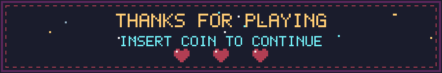

<div align="center">



<br>


</div>


## 🎮 What is this?

A growing library of **marketing skill packs**. Every skill ships as its own **`.zip`** at the repo root — grab the one you need and plug it into your workflow.

Covers four areas: **SEO**, **content & copy**, **research & strategy**, and **automation**.


## 🕹️ Select your skill



### 🔍 SEO

| # | Skill pack | Focus | Size |
|:-:|------------|-------|-----:|
| 01 | [`Seo-auditor.zip`](Seo-auditor.zip) | SEO auditing | 4.5 KB |
| 08 | [`keyword-research.zip`](keyword-research.zip) | Keyword research | 14.4 KB |
| 13 | [`seo-content-writer.zip`](seo-content-writer.zip) | SEO content writing | 13.2 KB |
| 14 | [`seo-off-page-backlinks.zip`](seo-off-page-backlinks.zip) | Off-page SEO & backlinks | 25.9 KB |

### ✍️ Content & copy

| # | Skill pack | Focus | Size |
|:-:|------------|-------|-----:|
| 02 | [`article-content.zip`](article-content.zip) | Article content | 4.7 KB |
| 04 | [`content-writer.zip`](content-writer.zip) | Content writing | 21.2 KB |
| 07 | [`humanizer.zip`](humanizer.zip) | Humanizing AI-written text | 31.0 KB |
| 09 | [`landing-page.zip`](landing-page.zip) | Landing pages | 3.5 KB |
| 10 | [`linkedin-marketing.zip`](linkedin-marketing.zip) | LinkedIn marketing | 2.2 MB |

### 📊 Research & strategy

| # | Skill pack | Focus | Size |
|:-:|------------|-------|-----:|
| 03 | [`competitor-analysis.zip`](competitor-analysis.zip) | Competitor analysis | 12.5 KB |
| 05 | [`deep-research-master.zip`](deep-research-master.zip) | Deep research | 9.8 KB |
| 06 | [`find-skills.zip`](find-skills.zip) | Skill discovery | 2.7 KB |
| 12 | [`performance-marketer.zip`](performance-marketer.zip) | Performance marketing | 28.8 KB |

### ⚙️ Automation

| # | Skill pack | Focus | Size |
|:-:|------------|-------|-----:|
| 11 | [`n8n-workflow-patterns.zip`](n8n-workflow-patterns.zip) | n8n workflow patterns | 37.7 KB |


## ⚡ Quick start

**1. Clone the repo**

```bash
git clone https://github.com/ismailgito/Marketing-skills.git
cd Marketing-skills
```

**2. Pick a skill pack** from the tables above — each one is a single ZIP file.

**3. Load it** into your AI assistant or agent's skills setup, then ask it to do the job the pack is named for.

> 💡 **Tip:** you only need the ZIPs you'll actually use. Download a single file straight from the repo page instead of cloning everything.

## 🗂️ Repo map

```text
Marketing-skills/
├── assets/                      # pixel-art animations used in this README
│   ├── banner.svg
│   ├── divider.svg
│   ├── loading.svg
│   ├── skill-select.svg
│   └── footer.svg
├── Seo-auditor.zip
├── article-content.zip
├── competitor-analysis.zip
├── content-writer.zip
├── deep-research-master.zip
├── find-skills.zip
├── humanizer.zip
├── keyword-research.zip
├── landing-page.zip
├── linkedin-marketing.zip
├── n8n-workflow-patterns.zip
├── performance-marketer.zip
├── seo-content-writer.zip
├── seo-off-page-backlinks.zip
└── README.md
```

## 🤝 Contributing

Got a skill that belongs here? Open an issue or a pull request with your skill packed as a single `.zip`, named in `lowercase-with-dashes`.



<div align="center">

Maintained by [@ismailgito](https://github.com/ismailgito)

</div>
